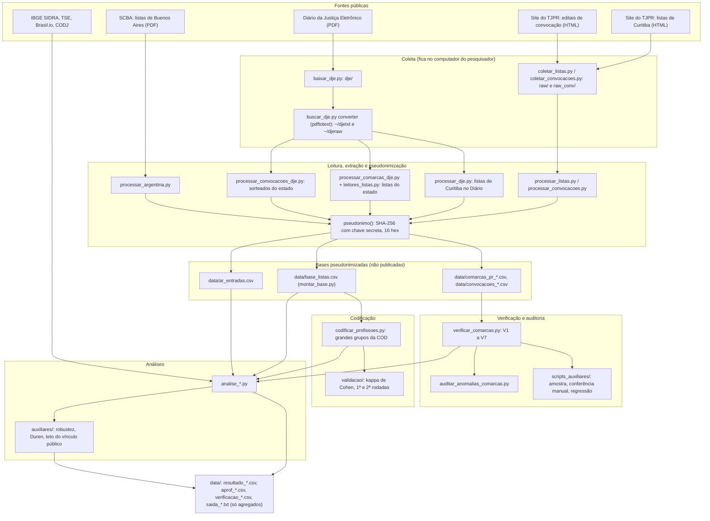

# Quem compõe a lista?

Código, regras de classificação, protocolo e resultados agregados da pesquisa **"Quem compõe a lista? Perfil ocupacional e renovação das listas gerais de jurados em Curitiba e no Paraná"**, de Gabriel Pinto Cardoso, com orientação de Khalil Aquim (Faculdade Inspirar, Curitiba).

A pesquisa lê as listas gerais de jurados que o art. 426 do Código de Processo Penal manda publicar com a profissão de cada alistado e as compara com a estrutura ocupacional da população (Censo 2022) e com o eleitorado (TSE, 2024). Reúne 71 listas das duas Varas do Tribunal do Júri de Curitiba (2009 a 2027), 644 listas de outras 127 comarcas do Paraná veiculadas no Diário da Justiça Eletrônico (agosto de 2022 a outubro de 2026), os editais de convocação dos jurados sorteados e, para comparação, as listas da Província de Buenos Aires (2024 a 2026). Os nomes são pseudonimizados no momento da leitura e só resultados agregados saem do computador do pesquisador.

**Estado do repositório.** Versão de outubro de 2026 (commit inicial `6343bac`, seguido de README técnico, ajustes de proteção de dados e resultado da 2ª rodada de validação), que acompanha a versão de 14/10/2026 do texto. A segunda rodada de validação da codificação foi concluída em 14/10/2026 (ver [Validação da codificação](#validação-da-codificação)).

## Sumário

- [Visão geral e arquitetura](#visão-geral-e-arquitetura)
- [Organização do repositório](#organização-do-repositório)
- [Fontes de dados](#fontes-de-dados)
- [Pipeline etapa a etapa](#pipeline-etapa-a-etapa)
- [Leitura e extração](#leitura-e-extração)
- [Pseudonimização](#pseudonimização)
- [Verificações automáticas e auditoria](#verificações-automáticas-e-auditoria)
- [Codificação das profissões](#codificação-das-profissões)
- [Medidas e métodos estatísticos](#medidas-e-métodos-estatísticos)
- [Mapa de saídas](#mapa-de-saídas)
- [Reprodutibilidade](#reprodutibilidade)
- [Proteção de dados e ética](#proteção-de-dados-e-ética)
- [Limitações conhecidas](#limitações-conhecidas)
- [Como citar](#como-citar)
- [Licença](#licença)
- [Histórico de versões](#histórico-de-versões)

## Visão geral e arquitetura

O trabalho segue as etapas do processo de descoberta de conhecimento em bases de dados (seleção, pré-processamento, transformação, mineração e interpretação), descritas no capítulo 3 de `PROTOCOLO.md`. No código, isso se traduz em quatro camadas: **coleta** (documentos públicos baixados e guardados localmente), **leitura** (extração das entradas e pseudonimização na mesma passada), **verificação e codificação** (testes por lista, auditoria, classificação das profissões) e **análise** (medidas agregadas gravadas em `data/`).



O ponto central da arquitetura é que **nenhum nome sai da etapa de leitura**: os scripts de leitura chamam `pseudonimo()` (definida em `coletar_listas.py`) antes de gravar qualquer linha, e as bases em `data/` guardam só o identificador. Os documentos originais, os textos extraídos e as bases com uma linha por alistado ficam fora do repositório (ver [Proteção de dados e ética](#proteção-de-dados-e-ética)).

## Organização do repositório

| Caminho | Conteúdo |
| --- | --- |
| `PROTOCOLO.md` | Capítulo de metodologia e Apêndice A (notas metodológicas) do texto |
| `ROBUSTEZ.md` | Testes de robustez feitos depois dos pareceres externos (14/10/2026) |
| `rodar_tudo.py` | Menu e cadeia de execução (etapas 1 a 7 e coletas com internet) |
| `coletar_listas.py`, `coletar_convocacoes.py`, `baixar_dje.py` | Coleta no site do TJPR e no Diário da Justiça |
| `dje_comum.py`, `buscar_dje.py` | Funções comuns e buscas no texto do Diário (conversão, localização, identificação de listas) |
| `processar_listas.py`, `processar_convocacoes.py`, `processar_dje.py`, `montar_base.py` | Leitura das listas e convocações de Curitiba e montagem da base única |
| `processar_comarcas_dje.py`, `leitores_listas.py`, `processar_convocacoes_dje.py` | Leitura das listas e convocações das demais comarcas no Diário |
| `processar_codj.py`, `processar_argentina.py` | Tabela de comarcas, entrâncias e municípios (CODJ); listas de Buenos Aires |
| `verificar_comarcas.py`, `auditar_anomalias_comarcas.py` | Verificações automáticas por lista e por comarca; relatório de anomalias |
| `codificar_profissoes.py`, `codificacao_profissoes.csv` | Regras de classificação das profissões e tabela grafia → categoria (filtrada) |
| `analise_*.py` | Análises (perfil, renovação, sorteados, sexo, eleitorado, censo estadual, Buenos Aires) |
| `auxiliares/` | Testes de robustez, teste de Duren e simulação, teto do vínculo público, teste de H3 |
| `scripts_auxiliares/` | Auditoria manual, teste de regressão, comparação com a versão congelada, rodada estadual em etapas |
| `validacao/` | Validação da codificação: 1ª rodada (amostra, gabarito, kappa) e 2ª rodada (regras congeladas) |
| `data/` | Somente resultados agregados e a tabela de comarcas (`codj_comarcas.csv`) |
| `LICENSE`, `.gitignore` | Licença MIT do código; lista do que nunca é versionado |

## Fontes de dados

| Fonte | Endereço | Período | O que se extrai | Script |
| --- | --- | --- | --- | --- |
| Listas de jurados das Varas do Júri de Curitiba (site do TJPR) | <https://www.tjpr.jus.br/lista-de-jurados> | 2009 a 2027 (listas provisórias e definitivas) | Número de ordem, nome (pseudonimizado), profissão; título da publicação (caráter e ano) | `coletar_listas.py` (coleta), `processar_listas.py` (releitura) |
| Editais de convocação de jurados (site do TJPR) | <https://www.tjpr.jus.br/editais-convocacao-jurados> | 2008 a 2026 (nomes a partir de 2015) | Sorteados de cada reunião, por Vara, ano e mês | `coletar_convocacoes.py`, `processar_convocacoes.py` |
| Diário da Justiça Eletrônico do TJPR | <https://portal.tjpr.jus.br/e-dj/publico/diario/pesquisar.do> | Janelas de 2009 a 2013 (listas ausentes do site); todas as edições de 1º/08/2022 a 09/10/2026 | Listas de Curitiba ausentes do site; editais de lista e de convocação das demais comarcas | `baixar_dje.py`, `buscar_dje.py`, `processar_dje.py`, `processar_comarcas_dje.py`, `processar_convocacoes_dje.py` |
| IBGE, SIDRA, tabela 10264 (Censo 2022) | <https://sidra.ibge.gov.br/tabela/10264> | 2022 | Pessoas ocupadas de 14 anos ou mais por grande grupo de ocupação, Curitiba e municípios do Paraná | Valores de Curitiba fixados em `analise_perfil.py`; JSON dos municípios lido por `analise_censo_estadual.py` e `analise_comarcas.py` |
| IBGE, SIDRA, tabela 3592 (Censo 2010) | <https://sidra.ibge.gov.br/tabela/3592> | 2010 | Pessoas ocupadas de 10 anos ou mais por grande grupo, Curitiba (teste de robustez) | `analise_censo2010.py` |
| IBGE, SIDRA, tabela 10261 (Censo 2022) | <https://sidra.ibge.gov.br/tabela/10261> | 2022 | Vínculo público entre os ocupados de Curitiba (12,1%, citado na seção 4.5) | Não lida por script; valor citado no texto |
| TSE, perfil do eleitorado 2024 | <https://cdn.tse.jus.br/estatistica/sead/odsele/perfil_eleitorado/perfil_eleitorado_2024.zip> | 2024 | Eleitores por município, gênero, faixa etária e escolaridade; também a relação oficial dos 399 municípios do PR | `analise_tse.py`, `analise_comarcas.py`, `analise_censo_estadual.py`, `processar_comarcas_dje.py`, `processar_codj.py`, `auxiliares/_robustez_2026-10-14.py` |
| Gênero dos nomes (Brasil.io, a partir do Censo 2010) | <https://brasil.io/dataset/genero-nomes/> (código: <https://github.com/turicas/genero-nomes>) | Censo 2010 | Frequência feminina e masculina de cada prenome | `analise_sexo.py`, `dje_comum.sexo()` |
| CODJ do Paraná (Lei estadual nº 14.277/2003): Anexo I (entrâncias, versões de 2010 e de 08/01/2018) e Anexo III, Tabela 2 (composição das comarcas, versão de 2015) | Anexo I de 2018: <https://www.tjpr.jus.br/documents/17012/2505732/01+ANEXO+I+-+ENTRANCIAS.pdf>; demais versões no portal do TJPR | 2010, 2015, 2018 | Entrância de cada comarca e municípios que a compõem | `processar_codj.py` → `data/codj_comarcas.csv` |
| Suprema Corte de Justicia da Província de Buenos Aires: listados principales de jurados | <https://www.scba.gov.ar/institucional/nota.asp?id=58172> | 2024 a 2026 | Departamento judicial, partido, documento (pseudonimizado), nome (pseudonimizado), terminação sorteada | `processar_argentina.py` |

Notas sobre as fontes:

- **Coleta automatizada existe só para o site do TJPR e para o Diário.** Os arquivos de referência (IBGE, TSE, Brasil.io, CODJ) e os PDFs de Buenos Aires são obtidos à mão e colocados nos caminhos que os scripts esperam: `referencias/dados_ibge/SIDRA_10264_Parana_municipios_grupos_ocupacao.json`, `referencias/dados_ibge/SIDRA_3592_Curitiba_grupos_ocupacao_2010.json`, `referencias/dados_tse/perfil_eleitorado_2024.zip` (com `perfil_eleitorado_2024_PR.csv` dentro), `referencias/dados_nomes/nomes.csv.gz`, `referencias/normas/CODJ_Anexo_I_entrancias_2010.pdf`, `referencias/normas/CODJ_Anexo_I_entrancias_2018.csv` (transcrição do PDF de 2018), `referencias/normas/CODJ_Anexo_III_Tabela_2_composicao_2015.pdf` e `argentina/raw_ar/lista_<ano>.pdf`. A pasta `referencias/` não é versionada.
- **Padrão de jurados da Cidade Autônoma de Buenos Aires (2025)**, usado na seção 6.1, entra no texto a partir das resoluções do Consejo de la Magistratura, sem script neste repositório.
- **Datas do Diário.** Registra-se a data de veiculação; pela Lei nº 11.419/2006 (art. 4º, § 3º), a publicação considera-se feita no primeiro dia útil seguinte.

## Pipeline etapa a etapa

### O menu `rodar_tudo.py`

`rodar_tudo.py` não reescreve nada: cada etapa chama o script correspondente, mostra a saída na tela, acrescenta-a a `rodar_tudo_log.txt` e, nas análises, grava também `data/saida_<analise>.txt`.

```
python3 rodar_tudo.py              # abre o menu
python3 rodar_tudo.py tudo         # cadeia sem internet: etapas 1, 2, 5, 6 e 7
python3 rodar_tudo.py 5 6 7        # só as etapas indicadas, nessa ordem
python3 rodar_tudo.py analises     # só a etapa 7
```

| Etapa | Script chamado | Entrada | Saída | Observação |
| --- | --- | --- | --- | --- |
| 1 | `processar_listas.py` | `raw/*.html` | `data/documentos.csv`, `data/entradas.csv`, `data/linhas_descartadas.csv` | Relê o HTML já baixado, sem acessar o site |
| 2 | `processar_convocacoes.py` | `raw_conv/*.html` | `data/convocacoes_documentos.csv`, `data/convocacoes.csv` | Idem, para os editais de convocação |
| 3 | `buscar_dje.py converter` | `dje/*.pdf` | `~/djetxt/*.txt` (`pdftotext -layout`) e `~/djeraw/*.txt` (`pdftotext` padrão) | Pulada se `pdftotext` não estiver instalado. Fora do "tudo" |
| 4 | `processar_dje.py ~/djeraw todos` | Texto do Diário e `data/entradas.csv` | `data/dje_documentos.csv`, `data/dje_entradas.csv` (e as versões `_2013`) | Pulada se não houver texto em `~/djeraw`. Fora do "tudo" |
| 5 | `montar_base.py` | `data/entradas.csv`, `data/dje_entradas.csv` | `data/base_listas.csv` | Base única de Curitiba |
| 6 | `codificar_profissoes.py` | `data/base_listas.csv` | `codificacao_profissoes.csv` | Ver o filtro de publicação em [Codificação das profissões](#codificação-das-profissões) |
| 7 | 13 análises, na ordem abaixo | Bases de `data/` e `referencias/` | `data/resultado_*`, `data/aprof_*`, `data/verificacao_*`, `data/saida_*.txt` | |

Ordem das análises na etapa 7: `analise_renovacao.py`, `analise_perfil.py`, `analise_vinculo_publico.py`, `analise_convocacoes.py`, `analise_isentos.py`, `analise_sexo.py`, `analise_tse.py`, `analise_aprofundada.py`, `analise_comarcas.py`, `verificar_comarcas.py`, `analise_censo_estadual.py`, `analise_convocacoes_estado.py`, `analise_argentina.py`. A ordem importa: `analise_tse.py` lê `resultado_sexo.csv`, `analise_censo_estadual.py` lê as saídas de `verificar_comarcas.py`, e `analise_aprofundada.py` importa as definições de `analise_vinculo_publico.py`.

Opções com internet ou de consulta no mesmo menu:

| Código | Ação |
| --- | --- |
| `C` | `coletar_listas.py`: percorre <https://www.tjpr.jus.br/lista-de-jurados> e a paginação, guarda o HTML em `raw/` |
| `V` | `coletar_convocacoes.py`: percorre os editais de convocação das duas Varas, guarda em `raw_conv/` |
| `D` | `baixar_dje.py` com predefinições (`curitiba`, `cascavel`, `cascavel2`, `2013`), `ano <AAAA>` (janelas do art. 426: 1º a 15/10 e 3 a 14/11 do ano anterior) ou `periodo <início> <fim>` |
| `B` | `buscar_dje.py` nos modos `converter`, `identificar`, `localizar`, `editais`, `cascavel`, `profissao`, `varrer` (imprimem só datas, linhas, contagens e sobreposições) |

### Por que as etapas 3 e 4 ficam fora do "tudo"

`processar_dje.py` localiza as listas de Curitiba no Diário por **números de linha anotados à mão** na lista `CANDIDATOS` (por exemplo, `("2009-10-13_ed247", 186412, "provisoria", "2010")`). Esses números valem para o texto gerado pelo `pdftotext` 22.02 (poppler); outra versão pode deslocar as linhas e fazer o script ler outro trecho. Por isso o "tudo" reaproveita os `data/dje_*.csv` já gerados, e as etapas 3 e 4 só devem ser rodadas de propósito, conferindo `data/dje_documentos.csv` em seguida (colunas `n_entradas`, `vara_por_sobreposicao`, `sobreposicao`).

Observação: `rodar_tudo.py` passa `~/djeraw` (texto sem `-layout`) para `processar_dje.py`, conforme o comentário de `dje_comum.py` sobre o formato em que as linhas foram anotadas; a docstring de `processar_dje.py` ainda menciona `~/djetxt` como pasta padrão.

### O que não está na cadeia do menu

Algumas etapas são rodadas à parte, porque são longas ou dependem de material que não é baixado por script:

| Script | Como rodar | Saída | Usado por |
| --- | --- | --- | --- |
| `processar_comarcas_dje.py` | Sem argumentos (Laranjeiras do Sul e Cantagalo); `--todas` (todas as comarcas); `--todas --bruto --padrao=2023-0*` (um bloco de edições) e depois `--juntar` | `data/comarcas_extra_*.csv`; `data/comarcas_pr_editais.csv` e `data/comarcas_pr_entradas.csv`; brutos `data/comarcas_bruto_*` | `analise_comarcas.py`; `verificar_comarcas.py`, `analise_censo_estadual.py`, `analise_convocacoes_estado.py` |
| `processar_convocacoes_dje.py` | `--bruto --padrao=<bloco>` por bloco, depois `--juntar` | `data/convocacoes_editais.csv`, `data/convocacoes_entradas.csv` | `analise_convocacoes_estado.py` |
| `scripts_auxiliares/rodar_tudo.sh` | `listas1`, `listas2`, `conv1`, `conv2`, `conv2b`, `conv3`, `final`, nesta ordem | Rodada estadual completa em blocos semestrais, com logs em `auditoria/rodada_correcao/`; a etapa `final` roda as verificações, o censo estadual, as convocações e o teste de regressão | |
| `processar_codj.py` | Sem argumentos | `data/codj_comarcas.csv` | Censo estadual, convocações, robustez |
| `processar_argentina.py` | Sem argumentos | `data/ar_entradas.csv` | `analise_argentina.py` |
| `analise_censo2010.py` | Sem argumentos | `data/resultado_censo2010_curitiba.csv` | Teste de robustez (Censo 2010) |
| `auxiliares/_robustez_2026-10-14.py` | Da raiz: `python3 auxiliares/_robustez_2026-10-14.py` | `data/resultado_robustez_comarcas.csv`; texto em `data/saida_robustez_2026-10-14.txt` | `ROBUSTEZ.md`, Apêndice A |
| `auxiliares/_duren_simulacao.py`, `auxiliares/_teto_vinculo_publico.py`, `auxiliares/_h3_permanencia_desvio.py` | Da raiz | Só impressão na tela (não gravam arquivo em `data/`) | Seções 6.3 e 4.5; teste exploratório de H3 |

Consequência prática: o "tudo" refaz as análises do estado e de Buenos Aires **a partir das bases intermediárias já existentes** (`comarcas_*`, `convocacoes_*`, `ar_entradas.csv`); para regenerá-las desde o PDF é preciso rodar as linhas da tabela acima.

## Leitura e extração

### Listas e convocações do site (HTML)

- **Coleta.** `coletar_listas.py` percorre a página de listas e todas as páginas de paginação (até 600 páginas de índice), identifica-se como coleta acadêmica (`User-Agent` com "pesquisa-academica-IC-listas-jurados"), espera 1 segundo entre requisições e guarda o HTML de cada publicação em `raw/`. Publicação já baixada não é baixada de novo.
- **Vara.** Vem do identificador do publicador na URL: `s0CT` → 1ª Vara, `M4kc` → 2ª Vara, `5WKukPZuHBx9` → Cascavel. Nas convocações, `s0CT` e `qE2i`.
- **Caráter e ano.** Pelo título da publicação: contém "CONVOCA" → convocação; "PROVIS" → provisória; "DEFINI" → definitiva; "LISTA" → outra lista. O ano é o maior "20xx" do título.
- **Texto.** O HTML é cortado a partir do bloco de conteúdo (`journal-content-article` ou equivalentes), scripts e estilos são removidos, e as quebras de bloco (`<br>`, `<p>`, `<li>`, `<tr>` etc.) viram quebras de linha. Quando a página tem vários blocos de artigo, usa-se o que tem mais linhas numeradas.
- **Entrada.** Uma linha numerada casa com `^(\d{1,4})\s*[.\-–)]\s*(.+?)$`. Entradas coladas na mesma linha ("12.FULANO - X 13.BELTRANO") são separadas antes. Nome e profissão são separados no primeiro hífen, meia-risca ou travessão cercado de espaços (ou no fim da linha); o que vem antes é o nome, o que vem depois é a profissão.
- **Formatos.** `processar_listas.extrair()` devolve um de três formatos: `numerada` (50 ou mais linhas numeradas); `mista` (a numeração começa depois do 1 e as linhas sem número imediatamente anteriores completam o início); `sem_numeracao` (linhas "NOME - PROFISSÃO" de 2 a 9 palavras, sem dígitos e sem palavras de cabeçalho como EDITAL, TRIBUNAL, VARA).
- **Filtros.** Números de 2000 a 2035 que saltam a sequência são tratados como data do edital ("... de 2015. FULANO, Juiz") e descartados; nomes com menos de duas palavras são descartados e só registrados (documento, número, tamanho da linha) em `data/linhas_descartadas.csv`; número de ordem repetido na mesma página conta uma vez (conteúdo repetido).
- **Controle.** Cada documento registra `n_entradas` e `quebras_sequencia` (saltos na numeração) em `data/documentos.csv`.

### Listas de Curitiba no Diário (`processar_dje.py`)

A partir da linha anotada do cabeçalho, `extrair()` segue a numeração 1, 2, 3..., aceitando o número esperado ou até dois adiante, juntando a linha seguinte quando o nome termina em hífen, e, depois de 400 linhas sem entrada, procura adiante (até 20.000 linhas) o par "esperado, esperado + 1" para continuar a lista depois de quebra de página ou coluna. A Vara é atribuída por **sobreposição de pessoas** com as listas do site (anos vizinhos), e não pelo cabeçalho. `montar_base.py` só incorpora os seis documentos do Diário listados em `DJE_INCLUIR`, cada um com a Vara, o caráter, o ano e o grau de sobreposição registrados.

### Base única de Curitiba (`montar_base.py`)

Junta as listas provisórias e definitivas das duas Varas vindas do site e os seis documentos do Diário, com a coluna `fonte` (`site` ou `dje`). **Listas repetidas:** quando há mais de um documento para a mesma combinação (Vara, caráter, ano), fica o que tem mais entradas; é assim que os dois editais idênticos da 1ª Vara de 2023 viram uma lista só.

### Listas do estado no Diário (`processar_comarcas_dje.py` e `leitores_listas.py`)

1. **Páginas candidatas.** Pré-filtro no texto bruto da página e confirmação no texto reorganizado por colunas, pelas três redações de edital de lista: "foram alistados", "procedido o alistamento dos jurados" e "torna pública a lista" ou "relação". Editais "torna pública a relação" sem menção a jurados ou ao Júri nos 600 caracteres vizinhos são descartados.
2. **Reorganização das colunas** (`segmentos()`). Em cada página do texto `-layout`, o ponto de corte entre as duas colunas é a posição mais frequente de início de um bloco depois de três ou mais espaços (entre as colunas 60 e 140). Se esse corte separaria o número de ordem do nome (lista com espaço largo entre os dois), o corte recua para o início do número. Cabeçalhos e rodapés do Diário (data e número da edição, nome do Diário, número de página) viram linhas vazias antes da junção. As linhas de cada coluna são unidas por espaço e colunas e páginas são separadas por um caractere nulo, para que o texto de uma coluna nunca se misture ao da vizinha.
3. **Comarca** (`comarca_do_edital()`). Procura-se, na mesma coluna e até 1.500 caracteres antes da fórmula, uma referência "Júri/Comarca/Foro de X"; o nome é validado como o maior prefixo que coincide com um dos 399 municípios do Paraná (TSE). Na falta, usa-se o cabeçalho de seção do Diário na mesma coluna ("<MUNICÍPIO> JUÍZO ÚNICO", "VARA CRIMINAL" etc.) e, por último, a coluna anterior. A comarca lida depois da lista (`comarca_do_fecho()`) serve de conferência: o campo `confianca` registra `concorda`, `diverge` ou a origem (`mesma_coluna`, `mesma_coluna_secao`, `coluna_anterior`, `nenhuma`).
4. **Caráter e ano.** Na fórmula do edital, depois de removido o cabeçalho de página que às vezes cai no meio da frase: "caráter", "lista geral" ou "alistados" seguidos de "definitiv" ou "provisóri"; ano em "ano de 20xx". Caráter não declarado fica `?` até a passada global (item 8).
5. **Lista.** A leitura padrão (`extrair_lista()`) monta cadeias de marcadores "N." crescentes (saltos de até 3 números, até 6.000 caracteres entre marcadores), começando no 1 (ou até o 3, perto do edital), escolhe a cadeia longa mais próxima do edital e para antes do edital seguinte. `preencher_lacunas()` procura, só entre dois marcadores da cadeia, os números que faltam com padrão mais frouxo (nome em minúsculas, acento corrompido, caractere solto, número com um dígito a menos). Cada entrada vai do seu marcador ao seguinte sem atravessar troca de coluna, salvo quando o número fecha uma coluna e o nome começa na seguinte.
6. **Leituras alternativas,** na ordem do código: tabela "NOME | PROFISSÃO" lida pelas coordenadas das palavras no PDF (`pdftotext -bbox`, `ler_tabela_bbox()`), que prevalece sobre qualquer cadeia; nova divisão de colunas com corte mais largo; leitura tolerante quando a cadeia foi interrompida por salto de numeração e a tolerante rende 20% mais; lista sem número logo depois da fórmula quando a cadeia numerada começa a mais de 1.500 caracteres; parágrafo corrido quando rende ao menos o dobro (e 50 ou mais nomes); e, quando ainda há menos de 20 nomes, a leitura tolerante (cadeia que começa até o 60), a lista toda numerada "1.", a lista sem número uma por linha e o parágrafo corrido separado por ponto e vírgula ou vírgula. Os casos que motivaram cada regra estão no Apêndice A de `PROTOCOLO.md`.
7. **Limpeza da entrada.** `reparar()` desfaz acento corrompido por dupla codificação (UTF-8 lido como Latin-1, até três passadas); `CORTE` remove o texto do edital colado ao último nome (fórmulas de fecho, transcrição dos arts. 436 e seguintes); profissão só com dígitos (número de página) é esvaziada; uma segunda entrada embutida na profissão (número repetido no próprio Diário) é cortada e não contada. A profissão é gravada em minúsculas.
8. **Passadas globais** (com `--todas` ou `--juntar`). (a) **Edição com várias listas:** cada lista para antes do gatilho seguinte; o mesmo edital achado duas vezes na página conta uma vez; se a mesma lista (mais de 80% das mesmas pessoas, listas com mais de 30) aparece atribuída a duas comarcas na mesma edição, fica a comarca cujas listas de outros anos contêm mais dessas pessoas, e a outra vira `lista_nao_extraida_conflito`. (b) **Identidade:** lista de atribuição fraca ou sem comarca é reatribuída à comarca cujas listas de atribuição forte contêm 50% ou mais das mesmas pessoas e superam em 30 pontos a sobreposição com a própria (`reatribuida_por_identidade`). (c) **Caráter deduzido:** edital "?" posterior a uma provisória da mesma comarca e ano, sem definitiva, é a definitiva; dois editais "?" da mesma comarca e ano, ambos veiculados no ano anterior ao da lista, são provisória e definitiva, pela ordem. (d) A mesma entrada (comarca, edição, caráter, número, pessoa) lida duas vezes conta uma vez.
9. **Lacunas da publicação.** Números que faltam na lista e não aparecem em lugar nenhum do trecho do edital, nem com padrão frouxo, são registrados em `lacunas_publicacao` e descontados na verificação de numeração, até 10% da numeração.
10. **Republicações.** A extração guarda todas as veiculações; na análise (`analise_censo_estadual.py`, `analise_comarcas.py`) vale **a última veiculação** de cada combinação (comarca, caráter, ano).

### Convocações do estado (`processar_convocacoes_dje.py`)

Gatilhos: "ficam convocados", "foram sorteados", "sorteou ... jurados", "jurados sorteados", em páginas com "Júri". Só se aceita comarca lida na mesma coluna (`mesma_coluna`); o gatilho dos suplentes sem cabeçalho herda a comarca do gatilho anterior (até 1.500 caracteres, ou 4.000 se houver "suplente"). Os sorteados são a cadeia numerada até o gatilho seguinte; os suplentes vêm em cadeia própria ou na continuação da numeração dos titulares, e todos contam como sorteados. A mesma pessoa conta uma vez por edital (prevalece o papel de titular). Curitiba e Cascavel ficam de fora.

### Buenos Aires (`processar_argentina.py`)

Os PDFs são convertidos com `pdftotext -layout` para `~/artxt`. Cada linha com tipo de documento, número, "Apellido y Nombres" e partido vira uma entrada sob o "Departamento Judicial" corrente. A chave da pessoa é o documento completo pseudonimizado (`pseudo_doc()`, mesma chave, prefixo `|DOC|`); o nome pseudonimizado serve de teste de sensibilidade; a terminação de três dígitos sorteada é gravada à parte (é informação pública do sorteio).

## Pseudonimização

### Algoritmo

`coletar_listas.pseudonimo(nome, chave)`:

1. **Normalização do nome:** decomposição Unicode NFKD e descarte dos caracteres não ASCII (tira os acentos); tudo que não é letra vira espaço (pontuação e números somem: "FULANO;" e "FULANO" coincidem); espaços repetidos são reduzidos; caixa alta.
2. **Resumo:** `SHA-256(chave + "|" + nome_normalizado)`.
3. **Truncamento:** os primeiros 16 caracteres hexadecimais (64 bits) são o identificador `pessoa_id`.

```math
\mathrm{id} = \mathrm{trunc}_{64}\big(\mathrm{SHA256}(K \,\Vert\, \mathtt{|} \,\Vert\, N(\mathrm{nome}))\big)
```

$K$ é a chave, $N$ a normalização do item 1 e $\Vert$ a concatenação; o resultado é gravado na coluna `pessoa_id`. O mesmo nome gera o mesmo identificador em qualquer lista, fonte ou ano, o que permite medir permanência, repetição de sorteios e sobreposição entre listas (ligação determinística de registros). A mesma função é usada em todos os leitores (site, Diário, convocações) e em `buscar_dje.py`.

### Colisões

Com $b = 64$ bits e $n$ nomes distintos, a probabilidade de algum par de nomes diferentes receber o mesmo identificador é, pela aproximação do problema do aniversário,

```math
P(\text{colisão}) \approx 1 - e^{-n^2/2^{b+1}} \approx \frac{n^2}{2^{65}}
```

Para $n = 10^6$, $P \approx 2{,}7 \times 10^{-8}$, abaixo de uma em dez milhões.

### Homônimos e variações de grafia

O identificador depende só do nome escrito. **Homônimos** (pessoas diferentes com o mesmo nome) recebem o mesmo identificador e podem ser tomados pela mesma pessoa, o que superestima a permanência; **variações de grafia** do mesmo nome entre anos geram identificadores diferentes e subestimam a permanência. Os dois efeitos têm sentidos opostos; o protocolo estima que homônimos respondem por 1% a 3% de coincidência entre comarcas diferentes.

### Por que é pseudonimização, e não anonimização

Sem a chave, o identificador não permite recuperar o nome. Mas quem tiver a chave e uma lista de nomes candidatos pode recalcular os identificadores e compará-los (ataque de dicionário). É exatamente a pseudonimização do art. 13, § 4º, da LGPD: a associação ao indivíduo depende de informação adicional mantida separadamente pelo controlador. Por isso a chave e os originais nunca são publicados; os dados só se tornarão anonimizados quando a chave e os originais forem eliminados, ao fim do estudo.

### Como gerar a sua chave

A chave fica em `.chave_secreta`, na raiz. Se o arquivo não existir, `chave_secreta()` cria um automaticamente na primeira execução, com `secrets.token_hex(32)` (256 bits). Para criar o seu explicitamente:

```
python3 -c "import secrets; print(secrets.token_hex(32))" > .chave_secreta
```

Com outra chave, todos os identificadores mudam, mas as medidas agregadas não dependem dela (ver [Reprodutibilidade](#reprodutibilidade)). Não troque a chave no meio de uma rodada: as bases de Curitiba, do Diário e das convocações só se ligam entre si se tiverem sido geradas com a mesma chave.

## Verificações automáticas e auditoria

### Testes por lista (`verificar_comarcas.py`)

Aplicados a toda lista do estado com comarca identificada e 20 ou mais entradas. Saídas: `data/verificacao_comarcas_listas.csv` (por lista) e `data/verificacao_comarcas.csv` (por comarca).

| Teste | Medida | Critério de aprovação |
| --- | --- | --- |
| V1 numeração | Números distintos lidos ÷ (último número − lacunas da publicação) | ≥ 95%. Lista que começa depois do 1 mas é contínua (≥ 95% entre o primeiro e o último número) é marcada `parcial` e aprovada como amostra |
| V2 duplicatas | 1 − pessoas distintas ÷ entradas | ≤ 5% |
| V3 identidade | Parte das pessoas presentes em listas de **outras** comarcas (listas sem comarca não contam) | ≤ 10% (homônimos dão de 1% a 3%) |
| V4 profissão | Parte das profissões que carregam outra entrada ou o corpo do edital: número de ordem colado, CEP, telefone, parágrafo ou artigo de lei, ou mais de 120 caracteres | ≤ 5%, medida só com 20 ou mais profissões (títulos longos da CBO sem esses sinais passam) |
| V5 data | Ano da lista = ano da veiculação + 1, ou o próprio ano se veiculada de janeiro a setembro | Coerente |
| V7 atribuição | Lista de atribuição fraca (cabeçalho fora da coluna do edital) com menos de 20% de pessoas em comum com as listas de atribuição forte da comarca | Reprovada |

Por comarca, **V6 coerência temporal**: com dois ou mais anos de listas, exige-se alguma passagem de ano com 20% ou mais de permanência, salvo quando as listas do mesmo ano coincidem em 90% ou mais (renovação anual real, selo `verificada (renovacao anual)`). Uma lista reprovada em V1 a V5 ou V7 sai sozinha; só V6 reprova a comarca.

**Completude da profissão.** Não é critério de aprovação da lista: é medida (`pct_profissao`) e usada como filtro nas análises (perfil de Curitiba só com 70% ou mais; dissimilaridade das comarcas só com 50% ou mais e 50 ou mais entradas classificadas).

`auditar_anomalias_comarcas.py` complementa os testes com um relatório (só contagens) de editais com sinal de problema: tamanho atípico em relação à mediana da comarca, lista que não começa no 1, numeração incompleta, entradas inválidas, falha na verificação, caráter "?" e atribuição fraca.

### Resultado

| Etapa | Listas |
| --- | --- |
| Editais de lista localizados | 672 |
| Listas examinadas (comarca identificada, 20 ou mais nomes) | 667 |
| Aprovadas nas verificações | 661 (5 reprovadas em V5, 1 em V2) |
| Republicações da mesma comarca, caráter e ano (fica a última) | 17 |
| **Listas analisadas** | **644**, de 127 comarcas |

Conferível em `data/verificacao_comarcas_listas.csv` (667 linhas; 661 com `falhas = ok`), em `data/resultado_censo_editais.csv` (644 linhas) e em `data/saida_robustez_2026-10-14.txt` (seção 4).

Em Curitiba, o controle é a continuidade da numeração (`quebras_sequencia` em `data/documentos.csv`); todas as listas do período analisado têm de 99% a 100% das entradas lidas. Nas convocações de Curitiba, a correspondência entre fontes serve de teste: na mediana, 96% dos sorteados de cada edital constam da lista definitiva do mesmo ano e da mesma Vara (número do texto; não há script no repositório que grave essa mediana). No estado, `analise_convocacoes_estado.py` só usa editais de 2023 a 2026 com 10 ou mais sorteados **confirmados** pela lista da comarca (metade ou mais dos sorteados na lista do ano): 493 de 647, de 44 comarcas.

### Conferência manual por amostra

`scripts_auxiliares/gerar_amostra_auditoria.py` (semente 20261012) monta a planilha `auditoria/auditoria_editais.xlsx`, sem nomes: grupo A, 14 listas aleatórias por entrância (final, intermediária, inicial) entre as do censo; grupo B, casos difíceis escolhidos de propósito (tabela, uma linha por alistado, parágrafo corrido, lacunas, listas parciais, caráter deduzido, atribuição incerta); grupo C, 10 editais de convocação de 2023 a 2026 com 10 ou mais sorteados. Para cada lista, a planilha traz a página provável no PDF, o caráter e o ano lidos, o primeiro e o último número, e a profissão lida em três posições. `scripts_auxiliares/recortar_edital_auditoria.py` recorta as páginas do PDF (com `qpdf`) e lista os números não lidos. As colunas de conferência aceitam `ok`, `erro`, `dúvida` e `não se aplica`, e a instrução da planilha proíbe escrever nomes.

Resultado registrado no protocolo (conferência de 12/10/2026): 56 de 21.501 números de ordem não lidos (0,26%), uma profissão falsa, nenhum erro de caráter ou de ano, e a comarca errada em 1 de 21 listas aleatórias (intervalo exato de Clopper e Pearson, 95%: 0,1% a 23,8%). Como a amostra não estima essa taxa com precisão, todas as 640 listas extraídas na época foram testadas pela sobreposição de pessoas com as demais listas da mesma comarca: 624 confirmaram a atribuição, e as 16 restantes eram renovações integrais, salvo a lista atribuída à comarca errada, corrigida na versão final. O intervalo de Clopper e Pearson não é calculado por script do repositório.

### Teste de regressão

As falhas encontradas foram corrigidas no código (os comentários citam os códigos F1 a F10 da auditoria). Para garantir que a correção não criasse erros novos, a versão anterior do código e dos dados foi congelada em `auditoria/baseline_2026-10-12/` (fora do repositório), e os casos conferidos à mão foram reunidos em `auditoria/casos_teste.json`, só com pseudônimos.

| Script | O que faz |
| --- | --- |
| `scripts_auxiliares/testar_regressao.py` | (1) Casos de teste: nomes nas posições conferidas, entradas que estavam perdidas, profissões conferidas, sorteados e seu papel. (2) Comparação lista a lista com a versão congelada: entradas perdidas, ganhas, com identificador ou profissão alterados |
| `scripts_auxiliares/classificar_mudancas.py` | Roda o código velho e o novo nas mesmas edições, guarda em memória o nome por trás de cada pseudônimo e classifica cada identificador mudado (acento reparado, cauda removida, texto do Diário removido do meio etc.), imprimindo só formas mascaradas (letras viram A/a) |
| `scripts_auxiliares/classificar_profissoes.py` | Classifica as profissões que mudaram para a mesma entrada |
| `scripts_auxiliares/ligacao_mudancas.py` | Verifica se o identificador antigo e o novo reaparecem em outra edição da mesma comarca |
| `scripts_auxiliares/comparar_convocacoes.py`, `scripts_auxiliares/depurar_convocacao.py` | O mesmo para as convocações (titulares, suplentes, papel), com nomes mascarados |
| `scripts_auxiliares/varrer_editais_convocacao.py` | Varredura exploratória de editais de convocação por ano (só contagens) |

Resultado registrado no texto: nenhuma entrada perdida e 549 recuperadas; 290 identificadores mudados, todos explicados (115 por texto do edital removido do fim do nome, 85 pela entrada seguinte removida, 83 por acento reparado, 4 por cabeçalho removido do meio da entrada, 3 por número colado); 62 identificadores antes isolados passaram a reaparecer em outras edições da mesma comarca, e nenhum deixou de reaparecer; todos os casos do gabarito (49 nomes, 22 entradas que faltavam, 84 profissões, 127 sorteados) passaram, salvo quatro sorteados (três por erro de digitação no próprio gabarito, um por nome partido entre páginas).

### Limites que permanecem

Entradas com número de ordem repetido no próprio Diário não são contadas (41, 0,01% do total); cerca de 1% das leituras de convocação são trechos do edital, e não nomes (um filtro testado foi retirado porque eliminava titulares verdadeiros); perda estimada de entradas de cerca de 0,3% no estado e de no máximo 1% em Curitiba.

## Codificação das profissões

### Regras (`codificar_profissoes.py`)

- **Normalização:** sem acentos, caixa alta, sem marcas de gênero "(A)", "(O)", "/A", "/O", só letras, dígitos e espaços.
- **Regras ordenadas:** uma lista `REGRAS` de pares (categoria, expressão regular) é percorrida em ordem e **a primeira que casa vence**; sem nenhuma, a categoria é "Outros ou não classificado".
- **Categorias:** os dez grandes grupos da Classificação de Ocupações para Pesquisas Domiciliares (COD) do IBGE, a mesma do Censo 2022 (0 Forças armadas, policiais e bombeiros militares; 1 Diretores e gerentes; 2 Profissionais das ciências e intelectuais; 3 Técnicos e profissionais de nível médio; 4 Apoio administrativo; 5 Serviços e vendedores; 6 Agropecuária; 7 Operários e artesãos; 8 Operadores de máquinas e montadores; 9 Ocupações elementares), mais as marcações à parte: "Não informada", "Estudante ou estagiário" (inclui aprendiz, bolsista, acadêmico), "Aposentado" (inclui inativo, pensionista, reserva, reformado), "Do lar", "Desempregado", "Servidor público sem ocupação informada", "Empregado sem ocupação informada".
- **Precedência:** as marcações (estudante, aposentado, do lar, desempregado) vêm antes dos grupos, de modo que "professor aposentado" é Aposentado e "estudante de enfermagem" é Estudante. No topo ficam as regras específicas acrescentadas depois da validação ("operador de aparelhos" → grupo 8, "auxiliar de escritório" → grupo 4, "assistente de engenharia" → grupo 3, "operador de caixa" → grupo 5, "autônomo" e "capitalista" → não classificado), que precisam vencer as gerais.
- **Vínculo público:** a coluna `vinculo publico` da tabela marca grafias com termos de órgão ou cargo público (servidor, prefeitura, tribunal, polícia, estatais etc.). As análises do vínculo usam regras próprias, mais restritas, em `analise_vinculo_publico.py` (piso) e `auxiliares/_teto_vinculo_publico.py` (teto).
- **Universo do perfil:** só entram na comparação com o Censo as entradas classificadas num dos dez grupos; as marcações à parte e as não classificadas ficam fora do denominador.

### A tabela `codificacao_profissoes.csv`

Separador ponto e vírgula, codificação UTF-8 com BOM (abre no Excel). Colunas: grafia normalizada, frequência de 2014 a 2027 na base de Curitiba, categoria sugerida, vínculo público, revisão. O script gera todas as grafias (1.929 distintas de 2014 a 2027, segundo o texto). **A versão publicada é filtrada:** mantém só as grafias cujas palavras somam ao menos 50 ocorrências no conjunto (781 grafias, que cobrem 132.365 entradas, cerca de 95% do total), para que não se publiquem grafias raras em que a leitura automática possa ter colado parte do nome de outra entrada. O filtro é aplicado na preparação da publicação e não está em `codificar_profissoes.py`: rodar a etapa 6 regrava a tabela completa, que não deve ser versionada.

### Validação da codificação

**1ª rodada** (`validacao/`): `gerar_amostra.py` sorteia 200 **entradas** (não grafias) das listas definitivas de 2014 a 2026 com profissão informada (semente 20261011) e grava `amostra_para_codificar.csv` (só a profissão), `categorias.csv` e o gabarito `gabarito_NAO_ENVIAR.csv` (categoria do programa). `montar_planilha.py` monta a planilha de codificação às cegas (códigos 0 a 9, E, A, L, D, S, F, O). `calcular_kappa.py` calcula o acordo e o kappa de Cohen nas categorias completas e só no grande grupo. Resultado: 73,4% de acordo (kappa 0,68); corrigidas as regras defeituosas, o que mudou 2,2% das classificações, 80,4% (kappa 0,77). `codificar_profissoes_antes_validacao.py` e `resultado_perfil_antes_validacao.csv` / `resultado_perfil_depois_validacao.csv` documentam o efeito da correção. Como o acordo final foi medido na mesma amostra que motivou as correções, tende a superestimar o acordo em entradas novas.

**2ª rodada** (`validacao/rodada2/`): `gerar_rodada2.py` grava em `REGRAS_CONGELADAS.txt` o SHA-256 de `codificar_profissoes.py` (`bf62a983…`, que confere com a versão deste commit) e sorteia uma amostra nova de 200 entradas (semente 20261014, universo de 49.703 entradas), marcando no gabarito (não versionado) se a grafia já apareceu na 1ª rodada (136 das 200 repetem grafias da 1ª). `montar_planilhas_r2.py` gera uma planilha por codificador (pesquisador e segundo codificador independente). `calcular_kappa_r2.py` **recusa rodar se o hash das regras mudou**, e calcula acordo e kappa (categorias completas, grande grupo e só grafias novas), a matriz de confusão por grande grupo e, havendo dois codificadores, o kappa entre eles. **Resultado** (codificação do pesquisador, às cegas em relação à categoria do programa; saída em `validacao/rodada2/resultado_kappa_r2.txt`): acordo de 85,5% (171 de 200), kappa de 0,83 nas categorias completas e de 0,82 no grande grupo; nas 64 grafias novas, 79,7% e kappa de 0,76. Das 29 divergências, 15 vêm de uma só grafia, "administrador", que o programa põe no grupo 2 (como a COD faz com os profissionais de administração) e o codificador pôs no grupo 1; o efeito dessa escolha está em [Testes de robustez](#testes-de-robustez). Não houve segundo codificador independente, e o acordo entre pessoas fica por medir. A planilha preenchida e o gabarito da 2ª rodada não são versionados.

**Máscara "[…]".** Nas duas amostras publicadas, as palavras que não constam do vocabulário frequente da tabela de codificação foram substituídas por "[…]" (42 palavras em 32 entradas), pelo mesmo motivo do filtro da tabela. As categorias e o cálculo do kappa não dependem dessas palavras.

## Medidas e métodos estatísticos

Notação: $L_t$ é o conjunto de identificadores da lista do ano $t$; $l_g$ e $p_g$ são as proporções do grupo ocupacional $g$ na lista e na população ocupada, calculadas só sobre os grupos 0 a 9 (no Censo, excluídas as ocupações mal definidas).

### Razão de representação

```math
r_g = \frac{l_g}{p_g}
```

`analise_perfil.py` → `data/resultado_perfil.csv` (coluna `razao`). Universo: listas definitivas de 2014 a 2026 com 70% ou mais de profissão informada.

### Índice de dissimilaridade de Duncan

```math
D = 100 \cdot \frac{1}{2} \sum_{g=0}^{9} \left| l_g - p_g \right|
```

Parcela dos alistados que teria de mudar de grupo para que a lista reproduzisse a população.

- Curitiba, ano a ano (só listas com 70% ou mais de profissão): `analise_aprofundada.py` → `data/aprof_serie_anual.csv` (`indice_dissimilaridade_duncan`).
- Curitiba contra o Censo 2010 e o Censo 2022: `analise_censo2010.py` → `data/resultado_censo2010_curitiba.csv`.
- Comarcas do estado (lista mais recente de cada comarca, inteira quando houver, com 50% ou mais de profissão e 50 ou mais entradas classificadas; Censo somado sobre os municípios da comarca): `analise_censo_estadual.py` → `data/resultado_censo_comarcas_entrancia.csv` (`dissimilaridade_censo`).

### Permanência ano a ano

```math
P_t = \frac{|L_t \cap L_{t-1}|}{|L_t|}
```

- Curitiba: `analise_renovacao.py` → `data/resultado_renovacao.csv` (também "em algum ano anterior desde 2009", $|L_t \cap \bigcup_{s<t} L_s| / |L_t|$); série com "em alguma das duas anteriores" em `data/aprof_serie_anual.csv`. Provisória → definitiva do mesmo ano (saídas e entradas) e pessoas nas duas Varas: `data/saida_analise_renovacao.txt`.
- Comarcas: `analise_censo_estadual.py` (definitiva do ano ou, na falta, provisória; listas parciais fora) → `data/resultado_censo_comarcas.csv` (`permanencias_ano_a_ano`); Laranjeiras do Sul e Cantagalo em `data/resultado_comarcas_permanencia.csv`.
- Buenos Aires, pelo documento e só pelo nome: `analise_argentina.py` → `data/resultado_argentina_renovacao.csv`.

### Curva de sobrevivência (Kaplan e Meier)

Um "episódio" começa quando a pessoa aparece numa definitiva de $a_0 \in [2010, 2025]$ sem estar na do ano anterior; a duração conta os anos consecutivos de presença; o episódio é censurado se a pessoa ainda está na lista de 2026. Na 1ª Vara, a lista incompleta de 2023 é tratada como ponte: a pessoa conta como presente em 2023 se está nas listas de 2022 e de 2024.

```math
\hat S(t) = \prod_{u \le t} \left(1 - \frac{d_u}{n_u}\right)
```

$n_u$: episódios em risco com duração de ao menos $u$ anos; $d_u$: saídas observadas com duração exatamente $u$. A mediana é o primeiro $t$ com $\hat S(t) \le 0{,}5$. `analise_aprofundada.py` → `data/aprof_sobrevivencia_km.csv` (curva) e `data/aprof_sobrevivencia_resumo.csv` (permanência após 1, 3, 5 e 10 anos e mediana).

### Concentração dos sorteios

Sobre o número de convocações $x_{(1)} \le \dots \le x_{(n)}$ de cada pessoa convocada ao menos uma vez (2015 a 2026), com índice $i = 0, \dots, n-1$:

```math
G = \frac{\sum_{i=0}^{n-1} (2i - n + 1)\, x_{(i+1)}}{n \sum_{i} x_i}
```

Parte das convocações que cabe aos 10% mais convocados: soma dos $\lfloor n/10 \rfloor$ maiores valores dividida pelo total. O mesmo script conta as pessoas presentes em cinco ou mais listas e nunca convocadas. `analise_aprofundada.py` → `data/aprof_concentracao_convocacoes.csv`. Proporção da lista sorteada, repetição no ano e sorteados que seguem na lista do ano seguinte, por Vara e ano: `analise_convocacoes.py` → `data/saida_analise_convocacoes.txt`. No estado, por comarca e ano: `analise_convocacoes_estado.py` → `data/resultado_convocacoes_comarca_ano.csv`.

### Entradas em bloco e novatos

Novato: pessoa da definitiva do ano que não constava de nenhuma definitiva anterior da Vara desde 2009. Uma profissão é sinal de entrada em bloco quando está entre as quatro mais frequentes dos novatos, tem 30 ou mais novatos, é 5% ou mais dos novatos e ao menos o dobro da sua parte entre os veteranos. `analise_aprofundada.py` → `data/aprof_novatos.csv`. A tabela por profissão (`data/aprof_entradas_em_bloco.csv`) é gerada mas não publicada (está no `.gitignore`), porque traz grafias livres de profissão.

### Testes de Duren e Castaneda (seção 6.3)

`auxiliares/_duren_simulacao.py`, a partir de saídas já agregadas (`resultado_perfil.csv`, `aprof_serie_anual.csv`, `resultado_tse.csv`), imprime para cada Vara:

```math
\text{disparidade absoluta} = p_g - l_g, \qquad \text{disparidade comparativa} = \frac{p_g - l_g}{p_g}
```

e, para cada Vara e ano (2009 a 2026), o número de desvios-padrão pela aproximação normal da binomial:

```math
z = \frac{l_g - p_g}{\sqrt{p_g (1 - p_g) / n_c}}, \qquad n_c \approx n \cdot f \cdot (1 - e - a - h)
```

$n$: tamanho da lista; $f$: proporção com profissão; $e$, $a$, $h$: proporções de estudantes, aposentados e do lar (aproximação conservadora do número de entradas classificadas). Só anos com $n_c \ge 100$. Referências fixas no script: grupo 2 = 24,0%; grupos 7 a 9 = 9,6 + 6,2 + 9,8 = 25,6%. A saída vai só para a tela.

### Sexo pelo prenome

O primeiro termo do nome, sem acentos e só com letras, é procurado na tabela de prenomes (nome principal e grafias alternativas). Com $f$ e $m$ as frequências feminina e masculina do prenome no Censo 2010:

```math
\text{sexo} = \begin{cases} F & \text{se } f/(f+m) \ge 0{,}9 \\ M & \text{se } m/(f+m) \ge 0{,}9 \\ \text{indeterminado} & \text{caso contrário} \end{cases}
```

Prenome ausente da tabela: "não encontrado". A proporção de mulheres é calculada só entre os classificados (F + M). É estimativa de sexo provável atribuído pelo prenome, e não de identidade de gênero.

- Curitiba e Cascavel (site) e sorteados de Curitiba: `analise_sexo.py`, que **lê os nomes em `raw/` e `raw_conv/`** e por isso só roda no computador do pesquisador → `data/resultado_sexo.csv` (só contagens).
- Estado e Buenos Aires: `dje_comum.sexo()`, aplicado na leitura; o resultado entra nas bases como `sexo_prenome`.
- Comparação com o eleitorado de 18 a 69 anos: `analise_tse.py` → `data/resultado_tse.csv`, `data/resultado_sexo_vs_tse.csv`.

### Razões por mil eleitores

```math
\text{por mil} = 1000 \cdot \frac{\text{nomes na lista}}{\text{eleitores de 18 a 69 anos dos municípios da comarca}}
```

Eleitores de 18 a 69 anos: faixas etárias do TSE cuja idade mínima está entre 18 e 69 (o art. 436 exige 18 anos; o art. 437, IX, permite a dispensa a partir de 70). Municípios da comarca: `data/codj_comarcas.csv`. Listas parciais não entram. `analise_censo_estadual.py` → `data/resultado_censo_comarcas_entrancia.csv` (`por_mil_eleitores`); Laranjeiras do Sul e Cantagalo em `data/saida_analise_comarcas.txt` quando gerado.

### Prazos do art. 426

Provisória no prazo se veiculada até 10 de outubro, definitiva até 10 de novembro do ano anterior ao da lista, pela data de veiculação (critério tolerante diante da publicação no primeiro dia útil seguinte). As provisórias de 2027 ficam fora, porque a coleta terminou antes do fim do prazo. `analise_censo_estadual.py` → `data/resultado_censo_editais.csv` (`no_prazo_tolerante`) e `data/resultado_censo_comarcas.csv`.

### Vínculo público e isentos

- **Piso do vínculo público** (`analise_vinculo_publico.py` → `data/resultado_vinculo_publico.csv`): profissões com termo inequívoco de vínculo público, sobre as ocupações ativas (excluídos estudantes, aposentados, do lar e desempregados). **Teto** (`auxiliares/_teto_vinculo_publico.py`, só tela): soma ao piso professores, ocupações de saúde e cargos típicos em que o setor público é empregador relevante.
- **Isentos do art. 437** (`analise_isentos.py` → `data/resultado_isentos.csv`): categorias dos incisos VI a VIII por expressões regulares, com a marcação de aposentados ou da reserva e o número dos que foram sorteados no ano de vigência da lista. No repositório, o arquivo está agregado por inciso (ver [Proteção de dados e ética](#proteção-de-dados-e-ética)).

### Testes de robustez

`auxiliares/_robustez_2026-10-14.py` → `data/saida_robustez_2026-10-14.txt` e `data/resultado_robustez_comarcas.csv`; resumo em `ROBUSTEZ.md`.

`auxiliares/_robustez_administrador.py` → `data/saida_robustez_administrador.txt`: refaz o perfil de Curitiba (mesmo recorte de `analise_perfil.py`) com as grafias normalizadas "ADMINISTRADOR" e "ADMINISTRADORA" no grupo 1 em vez do 2. Na 1ª Vara (10,2% das ocupações classificadas), o grupo 2 passa de 49,7% para 39,5% e o grupo 1 de 8,0% para 18,2%; na 2ª Vara (2,1%), de 38,3% para 36,3% e de 6,0% para 8,1% (Censo 2022: grupo 1, 8,5%; grupo 2, 24,0%). A dissimilaridade vai de 26,0 para 25,5 e de 22,0 para 19,9: o desvio não depende da regra, muda só o grupo de topo em que aparece.

1. **Limites de pior caso para a profissão ausente.** Com $c_g$ entradas classificadas no grupo, $N$ classificadas e $m$ sem profissão, a participação do grupo fica entre $c_g/(N+m)$ (nenhuma ausente é do grupo) e $(c_g+m)/(N+m)$ (todas são).
2. **Completude alta.** O perfil e $D$ refeitos só com listas de 90% ou mais de profissão.
3. **Censo 2010.** `analise_censo2010.py`: $D$ contra os dois censos em todos os anos.
4. **Denominador alternativo.** Grupo 2 da lista contra a proporção de eleitores de 18 a 69 anos com superior completo (TSE), em Curitiba e nas comarcas.
5. **Simulação de sorteio.** Para cada comarca com dissimilaridade, 2.000 listas do mesmo tamanho sorteadas da distribuição ocupacional do Censo da comarca (multinomial, semente 20261014); compara-se $D$ observado com a média e o percentil 95 dos simulados.
6. **Completude na 1ª Vara.** Perfil das entradas com profissão nos anos de alta e de baixa completude.
7. **Fluxo das listas do estado** (672 → 667 → 661 → 644).

`auxiliares/_duren_simulacao.py` faz ainda a **simulação do procedimento de Buenos Aires em Curitiba**: uma lista de um jurado por mil eleitores de 18 a 69 anos e o intervalo de 95% esperado para cada nível de escolaridade, $\hat p \pm 1{,}96\sqrt{\hat p(1-\hat p)/n}$. `auxiliares/_h3_permanencia_desvio.py` calcula, sobre `resultado_censo_comarcas_entrancia.csv`, a correlação entre a permanência mediana e a dissimilaridade por comarca (teste exploratório da hipótese H3).

### Concordância (kappa de Cohen)

```math
\kappa = \frac{p_o - p_e}{1 - p_e}, \qquad p_e = \frac{1}{n^2} \sum_k n_{k}^{(1)} n_{k}^{(2)}
```

$p_o$: proporção de acordo; $n_k^{(1)}$, $n_k^{(2)}$: contagens da categoria $k$ em cada codificação. `validacao/calcular_kappa.py` e `validacao/rodada2/calcular_kappa_r2.py`.

## Mapa de saídas

Todos os arquivos de `data/` são agregados (sem identificador de pessoa).

| Arquivo | Conteúdo | Seção do texto |
| --- | --- | --- |
| `resultado_renovacao.csv` | Permanência das definitivas de Curitiba, por Vara e ano, e da provisória de 2027 | 4.2 |
| `saida_analise_renovacao.txt` | Permanência, anos de presença por pessoa, provisória → definitiva, pessoas nas duas Varas | 4.2, 4.3 |
| `aprof_serie_anual.csv` | Série 2009 a 2026: tamanho, permanência, completude, $D$, grupos 2, 5 e 7 a 9, estudantes, aposentados, do lar, vínculo público | 4.2, 6.2, 6.3 |
| `aprof_novatos.csv` | Novatos por Vara e ano | 4.2 |
| `aprof_sobrevivencia_km.csv`, `aprof_sobrevivencia_resumo.csv` | Curva de Kaplan e Meier e resumo | 4.2 |
| `resultado_censo2010_curitiba.csv` | $D$ e razões dos grupos 2 e 9 contra os Censos 2010 e 2022 | 3.3, 4.2, Apêndice A |
| `aprof_concentracao_convocacoes.csv` | Gini, top 10%, distribuição de convocações, nunca convocados | 4.4 |
| `saida_analise_convocacoes.txt` | Sorteados por Vara e ano, parte da lista sorteada, habituais, sorteados que seguem na lista | 4.4 |
| `resultado_perfil.csv`, `saida_analise_perfil.txt` | Perfil ocupacional de Curitiba contra o Censo 2022 | 4.5 |
| `resultado_vinculo_publico.csv`, `saida_analise_vinculo.txt` | Piso do vínculo público | 4.5, 4.7 |
| `resultado_isentos.csv`, `saida_analise_isentos.txt` | Isentos do art. 437 e sorteados entre eles | 4.6, Apêndice C |
| `resultado_sexo.csv`, `saida_analise_sexo.txt` | Sexo pelo prenome em Curitiba, Cascavel e sorteados de Curitiba | 4.8, 5.1 |
| `resultado_tse.csv`, `resultado_sexo_vs_tse.csv`, `saida_analise_tse.txt` | Eleitorado de Curitiba e Cascavel; mulheres na lista contra o eleitorado | 4.8, 5.1 |
| `resultado_comarcas_listas.csv`, `resultado_comarcas_permanencia.csv`, `resultado_comarcas_sexo.csv`, `resultado_comarcas_perfil.csv` | Laranjeiras do Sul e Cantagalo | 5.1 |
| `codj_comarcas.csv` | Comarca, entrância (Anexo I de 2018), municípios (Anexo III, Tabela 2) | 5.2, 5.3 |
| `verificacao_comarcas_listas.csv`, `verificacao_comarcas.csv` | Verificações V1 a V7 por lista e selo por comarca | 3.4, Apêndice A |
| `saida_censo_estadual.txt` | Registro da extração estadual (comarca, data, caráter, ano, contagens por edital) | 3.4, Apêndice A |
| `resultado_censo_editais.csv` | As 644 listas analisadas: prazo, tamanho, completude, mulheres, confiança da atribuição | 5.2 |
| `resultado_censo_comarcas.csv` | Por comarca: listas, prazos, tamanho médio, completude, mulheres, permanências, alertas | 5.2 |
| `resultado_censo_comarcas_entrancia.csv`, `saida_analise_censo_estadual.txt` | Por comarca e entrância: eleitores, por mil eleitores, $D$, prazos, permanências; medianas por entrância | 5.2 |
| `resultado_convocacoes_comarca_ano.csv`, `saida_analise_convocacoes_estado.txt` | Sorteados no estado por comarca e ano; medianas por entrância; comarcas sem lista no Diário | 5.3 |
| `resultado_argentina_tamanho.csv`, `resultado_argentina_renovacao.csv`, `resultado_argentina_sexo.csv`, `saida_analise_argentina.txt` | Buenos Aires: tamanho por departamento, permanência, sexo | 6.1 |
| `resultado_robustez_comarcas.csv`, `saida_robustez_2026-10-14.txt` | Testes de robustez | 3.6, 5.2, Apêndice A |
| `saida_robustez_administrador.txt` | Robustez da classificação de "administrador" | 4.5, Apêndice A |
| `validacao/resultado_perfil_antes_validacao.csv`, `validacao/resultado_perfil_depois_validacao.csv` | Perfil antes e depois da correção das regras | 3.3, Apêndice A |

Os resultados da seção 6.3 (Duren, desvios-padrão, simulação de Buenos Aires em Curitiba) vêm de `auxiliares/_duren_simulacao.py`, que só imprime na tela. A comparação entre o novo sorteio observado e o esperado nas comarcas (seção 5.3) e a mediana de 96% dos sorteados de Curitiba presentes na lista (seção 3.4) não são gravadas por nenhum script deste repositório.

## Reprodutibilidade

### Requisitos

- Python 3.10 ou superior. Os scripts de coleta, leitura e análise usam só a biblioteca padrão.
- `openpyxl`, só para as planilhas de validação e de auditoria (`validacao/`, `scripts_auxiliares/gerar_amostra_auditoria.py`, `scripts_auxiliares/recortar_edital_auditoria.py`): `pip install openpyxl`.
- Poppler: `pdftotext` (versão 22.02 para reproduzir as linhas anotadas de `processar_dje.py`; `-layout`, padrão e `-bbox` são usados) e `pdfinfo`. No macOS, `brew install poppler`.
- `qpdf`, só para recortar páginas na auditoria.
- Os arquivos de referência listados em [Fontes de dados](#fontes-de-dados), na pasta `referencias/`.

### Comandos

```
# 1. chave própria (ou deixe o primeiro script criá-la)
python3 -c "import secrets; print(secrets.token_hex(32))" > .chave_secreta

# 2. coleta (internet)
python3 coletar_listas.py
python3 coletar_convocacoes.py
python3 baixar_dje.py periodo 2022-08-01 2026-10-09
python3 baixar_dje.py curitiba
python3 baixar_dje.py 2013

# 3. texto do Diário e listas de Curitiba no Diário (conferir data/dje_documentos.csv)
python3 rodar_tudo.py 3 4

# 4. estado, convocações, comarcas e Buenos Aires
python3 processar_codj.py
python3 processar_comarcas_dje.py                  # Laranjeiras do Sul e Cantagalo
bash scripts_auxiliares/rodar_tudo.sh listas1      # e listas2, conv1, conv2, conv2b, conv3
python3 processar_argentina.py

# 5. junção das convocações, verificações e teste de regressão (este exige auditoria/, local)
bash scripts_auxiliares/rodar_tudo.sh final

# 6. cadeia sem internet e análises
python3 rodar_tudo.py tudo
python3 analise_censo2010.py
python3 auxiliares/_robustez_2026-10-14.py
```

### Volume e tempo

O texto registra 1.166 edições do Diário baixadas (978 de 1º/08/2022 a 09/10/2026 e 188 de 2009 a 2013), cerca de 4,6 GB em PDF. A coleta espera 1 segundo entre requisições. `scripts_auxiliares/rodar_tudo.sh` divide a rodada estadual em blocos semestrais de edições, cada um de cerca de 3 minutos segundo o próprio script.

### Determinismo

- As amostras usam sementes fixas: 20261011 (1ª rodada de validação), 20261014 (2ª rodada e simulação de sorteio), 20261012 (amostra de auditoria).
- A coleta e a leitura percorrem arquivos em ordem alfabética, e as passadas globais não usam acaso.
- Segundo o texto, a reexecução integral reproduziu os resultados arquivo por arquivo. Isso garante a reprodutibilidade computacional; a validade da extração depende da conferência manual, e a da inferência, do método.

### O que muda com outra chave

Mudam todos os `pessoa_id` e, portanto, as bases intermediárias, que não são publicadas. Não mudam as medidas agregadas, porque todas dependem só de igualdades entre identificadores, e a mesma chave é usada em todas as fontes; a única ressalva teórica são colisões, de probabilidade desprezível. Não é possível cruzar identificadores gerados com chaves diferentes.

### Limites da reprodução

- **Versão do `pdftotext`.** As linhas de cabeçalho de `processar_dje.py` valem para o poppler 22.02; a reorganização de colunas e o leitor de tabelas também dependem do leiaute produzido pela ferramenta.
- **Fontes que mudam.** O site do TJPR pode retirar, substituir ou republicar listas e editais; a paginação e os identificadores de publicador podem mudar. Uma nova coleta pode não encontrar o mesmo conjunto, e a coleta reaproveita o HTML já guardado em `raw/` e `raw_conv/` quando existe.
- **Material não baixado por script.** Referências do IBGE, do TSE, do Brasil.io, do CODJ e os PDFs de Buenos Aires precisam ser obtidos à mão.
- **Material local do pesquisador.** A versão congelada e o gabarito da auditoria (`auditoria/`) e os gabaritos da 2ª rodada não estão no repositório; sem eles, o teste de regressão e o cálculo do kappa não rodam.

## Proteção de dados e ética

### O que não está aqui, e por quê

As listas trazem nome e profissão de pessoas físicas. Embora publicadas por força de lei, o repositório não redistribui dados pessoais. Ficam de fora:

- os documentos originais (HTML do site, PDFs e textos do Diário, PDFs de Buenos Aires);
- as bases com uma linha por alistado, mesmo pseudonimizadas (`base_listas.csv`, `entradas.csv`, `comarcas_*`, `convocacoes*`, `ar_entradas.csv` etc.);
- a chave secreta;
- as grafias raras de profissão e a tabela de entradas em bloco;
- os gabaritos e as planilhas preenchidas da validação e da auditoria.

### Base legal (Lei nº 13.709/2018, LGPD)

- **Base do tratamento:** como a instituição tem categoria administrativa privada com fins lucrativos, não se enquadra como órgão de pesquisa (art. 5º, XVIII), o que afasta a base do art. 7º, IV. O tratamento fundamenta-se no **legítimo interesse (art. 7º, IX)**, lido à luz dos **§§ 3º e 7º do art. 7º** (dados de acesso público, tratados de forma compatível com a finalidade de controle social que justificou a publicação), com a ponderação do art. 10.
- **Pseudonimização na leitura (art. 13, § 4º),** descrita em [Pseudonimização](#pseudonimização).
- **Princípios:** finalidade, adequação, necessidade e segurança (art. 6º, I, II, III e VII).
- **Só agregados:** apenas resultados agregados são divulgados, e categorias com menos de cinco pessoas são reunidas. Por isso, a versão publicada de `data/resultado_isentos.csv` traz os isentos por inciso do art. 437 (VI, VII e VIII) e Vara, e não por categoria detalhada, que é a saída local de `analise_isentos.py`; a coluna `pessoas_soma_das_categorias` soma as categorias e pode contar a mesma pessoa mais de uma vez.
- **Eliminação:** os originais e a chave ficam só no computador do pesquisador enquanto o estudo prosseguir; depois serão eliminados, o que tornará os dados anonimizados (art. 5º, III, e art. 12).

**Ética em pesquisa.** O texto sustenta que a pesquisa se enquadra nas hipóteses do art. 1º, parágrafo único, II e V, da Resolução CNS nº 510/2016 (informações de acesso público e bancos de dados agregados), sem contato com jurados, questionário, entrevista ou acesso a dado sigiloso, e registra que cabe à instituição confirmar a dispensa. A etapa seguinte (atas e questionários dos Conselhos de Sentença) exigirá protocolo próprio. A argumentação completa está na seção 3.6 de `PROTOCOLO.md`.

**Cuidados no próprio código.** As buscas no Diário imprimem só datas, linhas, contagens e sobreposições; a auditoria e o teste de regressão mostram nomes apenas mascarados (letras viram A/a) e guardam o vínculo nome → pseudônimo só em memória; as planilhas de auditoria e de validação não trazem nomes; os textos do Diário ficam fora da pasta do projeto (`~/djetxt`, `~/djeraw`, `~/artxt`).

### Como o `.gitignore` impede publicar os originais

```
.chave_secreta          # a chave
raw/  raw_conv/         # HTML do site
dje/                    # PDFs do Diário
referencias/            # arquivos de referência
argentina/raw_*/        # PDFs de Buenos Aires
data/*                  # tudo em data/ é ignorado, exceto:
!data/resultado_*.csv
!data/saida_*.txt
!data/aprof_*.csv
!data/verificacao_*.csv
!data/codj_comarcas.csv
data/aprof_entradas_em_bloco.csv          # reexcluído (grafias livres)
validacao/rodada2/gabarito_r2_NAO_ENVIAR.csv
validacao/rodada2/codificacao_r2_*.xlsx
validacao/*.xlsx
__pycache__/
```

A regra para `data/` é de lista branca: tudo é ignorado e só os padrões de resultado agregado voltam a ser versionados. As bases com uma linha por alistado (`base_listas.csv`, `entradas.csv`, `comarcas_pr_entradas.csv`, `convocacoes.csv` etc.) não casam com nenhum desses padrões. Os textos do Diário e de Buenos Aires ficam fora da pasta do projeto, em `~/`. Ao acrescentar uma saída nova a `data/`, confira que ela não traz identificador de pessoa antes de usar um nome que case com os padrões liberados.

## Limitações conhecidas

- **A lista não é o Conselho de Sentença.** A pesquisa mede a primeira etapa do funil, não quem efetivamente julga; o sorteado também não é necessariamente jurado que julgou.
- **Ligação de registros.** Variações de grafia subestimam a permanência; homônimos a superestimam, em escala menor.
- **Profissão declarada e não verificada**, possivelmente desatualizada nas listas que repetem os mesmos nomes; aposentados que declaram a profissão antiga entram como ocupados.
- **Referência populacional.** O Censo retrata 2022 e conta pessoas a partir de 14 anos, enquanto os jurados têm 18 anos ou mais; o Censo 2010 conta a partir de 10 anos.
- **Filtros legais de elegibilidade** (notória idoneidade, exclusão do analfabeto sustentada pela doutrina) podem pesar mais sobre ocupações manuais e elementares e não puderam ser medidos.
- **Residência.** Nas comarcas com mais de um município, a lista pode concentrar-se na sede; sem endereço, não é possível medir.
- **Profissão ausente** em várias listas (na 1ª Vara de Curitiba, 35% de entradas com profissão em 2023, 21% em 2025, 10% em 2026): essas listas ficam fora do perfil e entram na renovação.
- **Lacunas de fonte.** Provisórias de 2009 das duas Varas e provisória de 2013 da 1ª Vara não localizadas; listas do Diário de 2010 a 2013 atribuídas à Vara por coincidência de nomes (71% e 26% nas de 2012 e 2013 da 2ª Vara); editais só afixados no fórum não deixam registro; publicações fora das janelas anteriores a agosto de 2022 não foram examinadas.
- **Leitura automática.** Perda estimada de cerca de 0,3% das entradas no estado e de até 1% em Curitiba; entradas com número repetido no próprio Diário não são contadas (41); cerca de 1% das leituras de convocação são trechos do edital.
- **Codificação.** As duas rodadas foram codificadas por um só pesquisador; o acordo entre pessoas não foi medido. A 1ª rodada mediu o acordo na amostra que motivou as correções; a 2ª, em amostra nova com regras congeladas.
- **Sexo pelo prenome** é estimativa de sexo provável; raça e endereço não são inferidos.
- **Comarcas pequenas** têm percentuais instáveis; as séries de sorteados por comarca cobrem no máximo quatro anos e só as 44 comarcas que publicam lista e convocação no Diário.
- **Inferência.** O desenho da reforma de 2011 da 2ª Vara oferece evidência sugestiva, e não identificação causal.

## Como citar

CARDOSO, Gabriel Pinto; AQUIM, Khalil. **Quem compõe a lista?** Código, protocolo e resultados agregados. Curitiba, 2026. Repositório de pesquisa.

## Licença

Código sob a licença MIT (`LICENSE`). Documentação e resultados agregados sob CC BY 4.0.

## Histórico de versões

| Versão | Commit | Descrição |
| --- | --- | --- |
| Outubro de 2026 | `6343bac` | Versão inicial pública: código de coleta, leitura, verificação, codificação e análise; protocolo; testes de robustez de 14/10/2026; 1ª rodada de validação completa e 2ª rodada preparada (regras congeladas); resultados agregados da versão de 14/10/2026 do texto |
| 14/10/2026 | `b2f19e7` | README técnico; isentos do art. 437 agregados por inciso; `.gitignore` ampliado; protocolo atualizado (290 identificadores) |
| 14/10/2026 | (este) | Resultado da 2ª rodada de validação (`validacao/rodada2/resultado_kappa_r2.txt`); teste de robustez de "administrador" (`auxiliares/_robustez_administrador.py`) |
